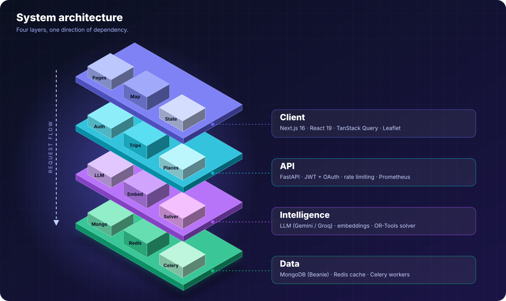
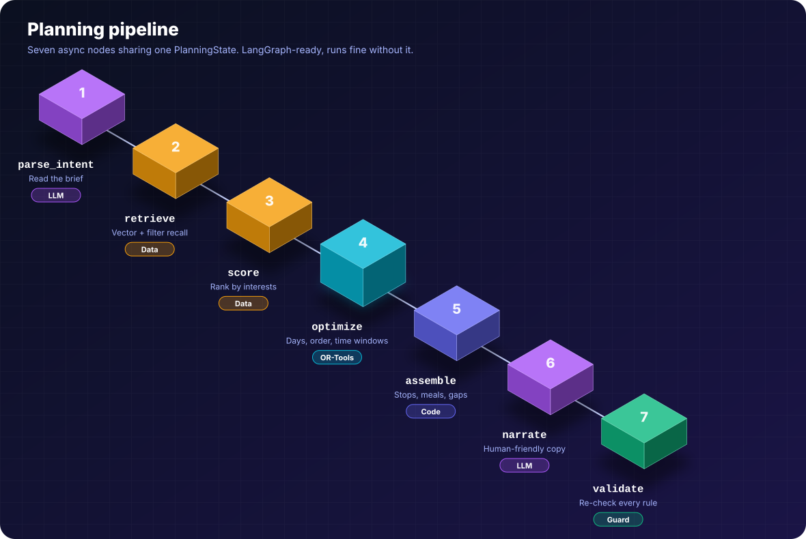
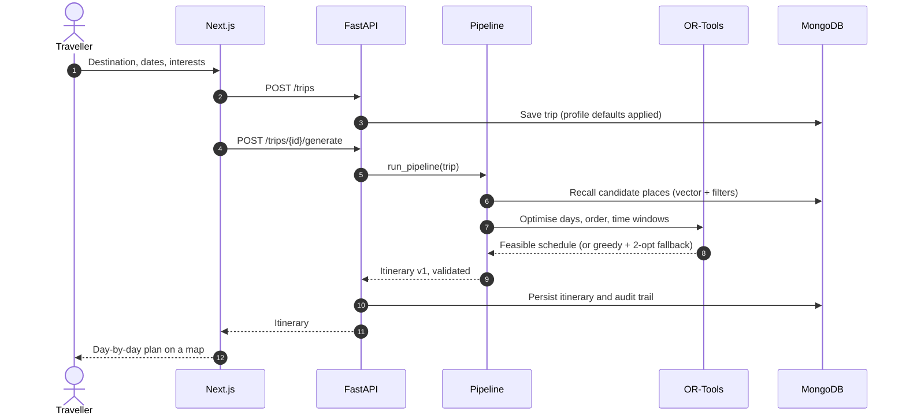
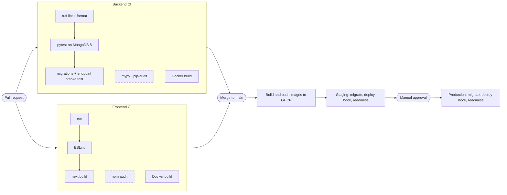

<div align="center">


<br>

[](../../actions/workflows/backend.yml)
[](../../actions/workflows/frontend.yml)
[](../../actions/workflows/deploy.yml)


**[Quick start](#-quick-start)** ·
**[Architecture](#-architecture)** ·
**[How it plans](#-how-it-plans-a-trip)** ·
**[API](#-api-at-a-glance)** ·
**[CI/CD](#-cicd)**

</div>

---

## ✨ Why this project is different

Most "AI trip planners" ask a language model to write the whole schedule. That
reads well and falls apart on contact with reality: places that are closed,
zig-zag routes, three museums in one afternoon.

This project splits the job along the line each tool is actually good at.

| | 🧠 The LLM | 🧮 Google OR-Tools |
|---|---|---|
| **Decides** | *What is worth doing*: interests, vibe, which places matter | *When and in what order*: days, sequence, timing |
| **Strength** | Taste, language, context | Hard constraints and optimisation |
| **Never trusted with** | Opening hours, distances, feasibility | Subjective judgement |

The solver treats **each day as a vehicle on one shared timeline**, so a single
solve decides *which day* a place lands on as well as its order. On the seeded
data that shortens routes from **27 km to 19 km** over three days in Paris and
from **18 km to 13 km** for a six-stop route in Rome.

<table>
<tr>
<td width="33%" valign="top">

### 🗺️ Constraint-aware
Opening hours, overnight gaps, visit durations, pace and daily distance caps
are enforced by the solver, not hoped for.

</td>
<td width="33%" valign="top">

### 🤖 Works with no API key
A deterministic stub provider runs the **full pipeline** offline. Add Gemini or
Groq when you want real prose.

</td>
<td width="33%" valign="top">

### 🔍 Auditable
Every generation records a per-stage trail at `/ai/runs`, and Prometheus
metrics track solver time and LLM tokens.

</td>
</tr>
</table>

---

## 🏗 Architecture

<div align="center">

</div>

<br>

| Layer | Directory | Stack | Docs |
|---|---|---|---|
| **Client** | [`frontend/`](frontend) | Next.js 16, React 19, TanStack Query, Zustand, Tailwind 4, Radix UI, Leaflet | [frontend/README.md](frontend/README.md) |
| **API** | [`backend/app/api`](backend/app/api) | FastAPI, JWT (single-use refresh rotation), Google/Apple OAuth, Argon2id | [backend/README.md](backend/README.md) |
| **Intelligence** | [`backend/app/ai`](backend/app/ai), [`optimization`](backend/app/optimization) | Gemini / Groq / Anthropic / OpenAI, embeddings, OR-Tools, optional LangGraph | |
| **Data** | [`backend/app/models`](backend/app/models) | MongoDB 8 (Beanie), Redis, Celery | |

The dependency rule is one-directional: **endpoints → services → models**. The
optimiser knows nothing about HTTP or MongoDB, which is why it is testable on its own.

---

## 🧭 How it plans a trip

<div align="center">

</div>

<br>



<details>
<summary><b>🔬 How the optimiser is modelled</b> (click to expand)</summary>

<br>

One **vehicle per day**, all sharing a single global timeline where day *d* owns
minutes `[d·1440, (d+1)·1440)`. Clustering by day first and routing each day
separately cannot trade a stop between days, and produces visibly worse plans.

| Constraint | How it is expressed |
|---|---|
| Opening hours | Per-node time windows, closed gaps punched out with `RemoveInterval` |
| Overnight | Removed from every node's domain, so nothing straddles midnight |
| Visit duration | Service time folded into the transit callback |
| Pace | A counting dimension caps places per day (relaxed 3 / moderate 5 / packed 7) |
| Daily distance | A distance dimension caps how far a day may range |
| Optional visits | Score-weighted drop penalties; the solver sheds the least interesting place instead of failing |
| Must-sees | Priced about 10⁴× higher than optional places |
| Unvisitable | A place closed on every trip day is pinned unperformed |

If OR-Tools is unavailable or returns nothing, a greedy nearest-neighbour
construction with a 2-opt pass takes over. It honours the same hard constraints
and is covered by the same tests.

</details>

---

## 🚀 Quick start

> **Prerequisites:** Docker with Compose, and Node.js 22+.

```bash
# 1 · Backend + MongoDB + Redis + worker (migrations run automatically)
cd backend
cp .env.example .env              # then set SECRET_KEY (see below)
docker compose up --build -d
docker compose exec api python -m scripts.seed_db --reset
curl http://localhost:8000/api/v1/health/ready

# 2 · Frontend
cd ../frontend
cp .env.example .env.local        # set NEXT_PUBLIC_MAPBOX_TOKEN for the map
npm ci
npm run dev                       # http://localhost:3000
```

| | URL |
|---|---|
| 🌐 App | <http://localhost:3000> |
| 📘 API docs | <http://localhost:8000/docs> *(disabled when `ENVIRONMENT=production`)* |
| ❤️ Readiness | <http://localhost:8000/api/v1/health/ready> |

**Demo logins after seeding:** `demo@example.com` / `demopassword1` and
`admin@example.com` / `adminpassword1`. **Never seed these into a real environment.**

```bash
# Generate a secret key
python -c "import secrets; print(secrets.token_urlsafe(48))"
```

<details>
<summary><b>🐍 Run the backend without Docker</b></summary>

<br>

```bash
cd backend
make dev          # venv + runtime, dev and optional AI dependencies
make run          # API with auto-reload on :8000
make reset        # drop and reseed the database
make test         # whole suite
make help         # every target
```

Needs Python 3.12 and a MongoDB you already run (`MONGODB_URI` in `.env`).

</details>

<details>
<summary><b>🤖 Turn on a real AI provider</b></summary>

<br>

The app runs with **no key** on a deterministic stub. For real plans, set one:

| `LLM_PROVIDER` | Key variable | Default model |
|---|---|---|
| `gemini` | `GOOGLE_GEMINI_KEY` | `gemini-3.8-flash` |
| `groq` | `GROQ_API_KEY` | `openai/gpt-oss-120b` |

Override with `LLM_MODEL` / `LLM_FAST_MODEL`. Providers retire models on a
schedule, so re-check their model pages before pinning one. If the key for the
chosen provider is missing, the API logs a warning and falls back to the stub.

</details>

<details>
<summary><b>🗄️ Database and migrations</b></summary>

<br>

- **Local:** compose starts a single-node MongoDB replica set.
- **Staging / production:** use MongoDB Atlas. Create a user with `readWrite` on
  one database only, restrict network access, and enable backups. Set
  `MONGODB_VECTOR_SEARCH_ENABLED=true` to use Atlas Vector Search.
- **Migrations** run with `sh backend/scripts/migrate.sh`. Compose runs it before
  the API starts, CI runs it in the smoke test, and the deploy pipeline runs it
  before each rollout. Each migration must stay compatible with the previous app
  version, because it runs before the new version starts.

</details>

---

## 🔌 API at a glance

49 operations under `/api/v1`. The full schema lives at `/docs`.

| Area | Highlights |
|---|---|
| 🔐 **Auth** | `register` · `login` · `refresh` (single-use rotation: replay is rejected) · `logout` · `logout-all` · `change-password` · Google and Apple sign-in |
| 📍 **Places** | Filtered list · `nearby` (2dsphere radius) · weighted full-text `search` · `semantic-search` (vector) · `cities` aggregation |
| 🧳 **Trips** | `POST /trips` · `POST /trips/{id}/generate` (**the pipeline**, 422 when no feasible plan exists) · `generate-async` on a worker · task polling · public `share` links |
| 🗓 **Itineraries** | Every version kept · `reorder` (times and legs recomputed server-side) · `optimize-route` over arbitrary places |
| 🧾 **AI** | `GET /ai/runs`: per-stage audit trail for every generation |
| 📈 **Ops** | `/health` · `/health/ready` (pings MongoDB) · `/metrics` (Prometheus) |

---

## 🧪 Testing

```bash
cd backend
pytest                                  # everything
pytest tests/test_optimization.py       # solver only, no database needed
pytest --cov=app --cov-report=term-missing

python -m scripts.verify_endpoints --base-url http://127.0.0.1:8000   # live end-to-end journey
```

Database-backed tests run against a **real MongoDB** on a throwaway database
(`TEST_MONGODB_URI`), because geospatial queries, text indexes and TTL behaviour
are exactly what a mock would fail to exercise. With no server reachable they
skip, so the pure-unit tests still run anywhere.

```bash
cd frontend
npx tsc --noEmit && npm run lint && npm run build
```

---

## 🚢 CI/CD



| Workflow | When | What |
|---|---|---|
| [`backend.yml`](.github/workflows/backend.yml) | PRs and pushes touching `backend/` | ruff, mypy (report-only), tests on real MongoDB, migrations + endpoint smoke test, `pip-audit` (report-only), Docker build |
| [`frontend.yml`](.github/workflows/frontend.yml) | PRs and pushes touching `frontend/` | `tsc`, **ESLint (blocking)**, `next build`, `npm audit` (report-only), Docker build |
| [`deploy.yml`](.github/workflows/deploy.yml) | Push to `main` | build and push images to GHCR → **staging** → **production** (after approval) |

Dashed boxes are reported, not blocking. [`dependabot.yml`](.github/dependabot.yml)
opens weekly update PRs for pip, npm, Docker and Actions.

<details>
<summary><b>🔧 One-time GitHub setup</b></summary>

<br>

1. **Branch protection** on `main`: require the Backend and Frontend CI checks and
   a review. `deploy.yml` does not re-run tests; it relies on this.
2. **Environments**: create `staging` and `production`. On `production`, add
   **Required reviewers** (this is the manual approval gate).
3. **Environment secrets** (per environment, same names):

   | Secret | Purpose |
   |---|---|
   | `DEPLOY_HOOK_URL` | Your host's deploy-hook URL (Render, Railway, Coolify, ...). Required. |
   | `MONGODB_URI` | Atlas connection string. Optional: omit to skip the CI migration step. |

4. **Environment variables:** `MONGODB_DB_NAME`.
   **Repository variables:** `STAGING_API_URL`, `PRODUCTION_API_URL` (no trailing slash).
   Optional: `RUN_STAGING_VERIFY=true` (full endpoint check on staging; it logs in as
   the seeded demo admin and makes real LLM calls), `BUILD_FRONTEND_IMAGE=true` plus
   `PRODUCTION_SITE_URL` and the `NEXT_PUBLIC_*` variables
   (`MAPBOX_TOKEN`, `GOOGLE_CLIENT_ID`, `APPLE_CLIENT_ID`, `APPLE_REDIRECT_URI`)
   if you self-host the frontend.
5. **On your host**, set the runtime variables from
   [`backend/.env.example`](backend/.env.example): `ENVIRONMENT`, `SECRET_KEY` (unique
   per environment), `MONGODB_URI`, `REDIS_ENABLED=true` + `REDIS_URI` + `CELERY_*`,
   `CORS_ORIGINS` (your real frontend origin only), `LLM_PROVIDER` and its key,
   `LOG_JSON=true`, `DEBUG=false`, `SENTRY_DSN`. Run **one** `beat` instance only;
   scale `worker` by adding replicas.

**Migrations from GitHub-hosted runners:** Atlas IP allow-lists cannot practically
include the runners' address ranges. If your database is locked down, leave
`MONGODB_URI` unset and run `sh scripts/migrate.sh` as your host's pre-deploy /
release command instead.

</details>

<details>
<summary><b>⏪ Rollback</b></summary>

<br>

Run the **Deploy** workflow manually (`workflow_dispatch`) with `image_tag` set to a
previous `sha-xxxxxxx`. It skips the build and redeploys that image through the same
staging → production path. Migrations are not rolled back automatically.

</details>

### Frontend hosting

Vercel works as-is (set the `NEXT_PUBLIC_*` variables in the project settings).
Alternatively self-host the image from [`frontend/Dockerfile`](frontend/Dockerfile);
`NEXT_PUBLIC_*` values are baked in at build time, so pass them as `--build-arg`.

---

## 📁 Project layout

```text
.
├── backend/
│   ├── app/
│   │   ├── api/v1/endpoints/   HTTP layer only, no business logic
│   │   ├── ai/                 LLM providers, prompts, embeddings, pipeline, graph
│   │   ├── optimization/       OR-Tools engine, distance maths
│   │   ├── services/           Business logic
│   │   ├── models/             Beanie documents (the schema)
│   │   ├── core/ db/ middleware/ observability/ schemas/ workers/
│   ├── migrations/             Data migrations (run by scripts/migrate.sh)
│   ├── scripts/                seed, migrate, verify_endpoints
│   └── tests/
├── frontend/
│   └── src/{app,components,hooks,lib,store,types}
├── docs/                       Generated README artwork (see below)
└── .github/                    Workflows, rollout action, Dependabot
```

<details>
<summary><b>🎨 Regenerating the 3D artwork</b></summary>

<br>

The isometric illustrations are generated from code, so they stay editable and
diff-able. Edit and re-run:

```bash
python docs/build_assets.py        # no dependencies; writes docs/assets/*.svg
```

</details>

---

## ⚠️ Known limitations

- Backend `mypy` reports type errors and is report-only for now. Remove
  `continue-on-error` in `backend.yml` once they are cleaned up.
- Access tokens are kept in `localStorage`. Add a Content Security Policy before launch.
- The in-process rate limiter is per-process; set `REDIS_ENABLED=true` in production.

<div align="center">
<br>
<sub>Built with FastAPI, Next.js and Google OR-Tools.</sub>
</div>
